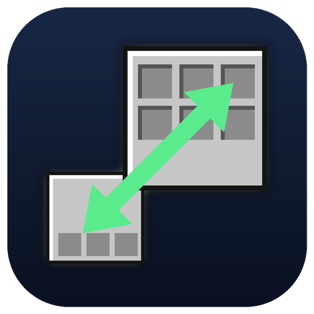

# Scaler



A client-side Fabric mod that lets parts of the GUI use their **own GUI scale** instead of the one
vanilla scale for everything.

| Part | What gets scaled |
|---|---|
| **Hotbar** | Hotbar plus hearts, hunger, armor, air, XP bar and the held item name |
| **Chat** | Chat messages and the chat box (clicking/hovering messages keeps working) |
| **Scoreboard** | The sidebar scoreboard |
| **Chests / Inventory** | Every container screen: inventory, creative, chests, furnaces, crafting... including tooltips and the player preview |

Each part can be turned on separately. When it's on, it's drawn at the GUI scale you set (for
example `2.37`) no matter what the vanilla GUI scale is. When it's off, the part looks exactly like vanilla.

## Settings

Open **Mod Menu → Scaler → Config**. Every part has:

- an **ON/OFF** button
- a **slider** (0.50 to 8.00, in steps of 0.01)
- a **text box** where you can type an exact value like `1.75`

The slider and text box stay in sync, and HUD changes show live behind the menu. Settings are saved
to `config/scaler.json`.

## Versions

| Minecraft | Jar |
|---|---|
| 1.21.11 | `scaler-<version>+1.21.11.jar` |
| 26.1 – 26.3 | `scaler-<version>+26.x.jar` |

Needs Fabric Loader. [Mod Menu](https://modrinth.com/mod/modmenu) is needed to open the settings screen.

## Building

The repo has two builds that share the code in `common/`:

```sh
./gradlew build            # 1.21.11 (JDK 21)  -> build/libs
cd mc26 && ./gradlew build # 26.1 - 26.3 (JDK 25) -> mc26/build/libs
```

## How it works

While a scaled part is drawn, Scaler scales the GUI pose by `custom scale / vanilla scale` and makes
the window report a matching GUI size, so the part lays itself out as if the whole game ran at that
scale. Chat uses its built-in scale value instead. Container screens are also given the matching size,
and mouse positions are converted so hovering and clicking slots works at any scale.

## License

MIT
